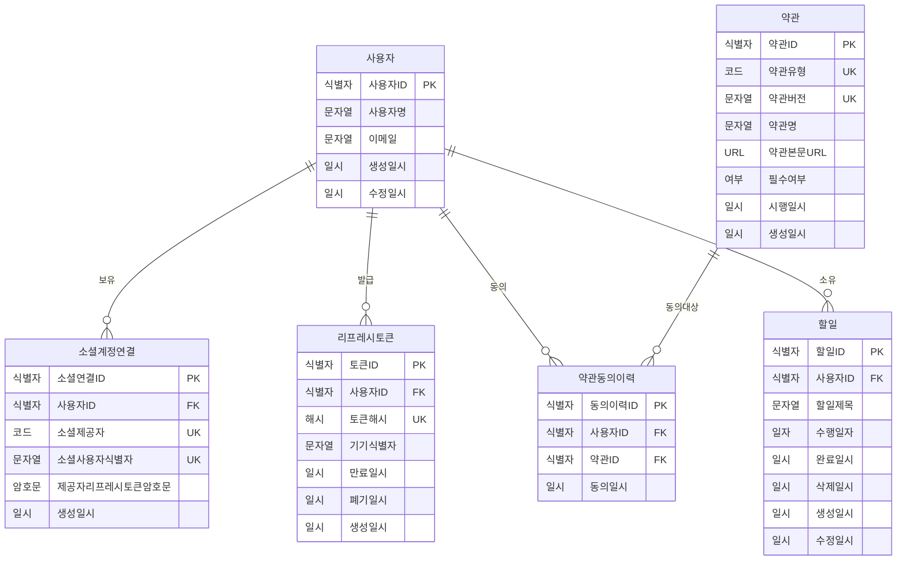
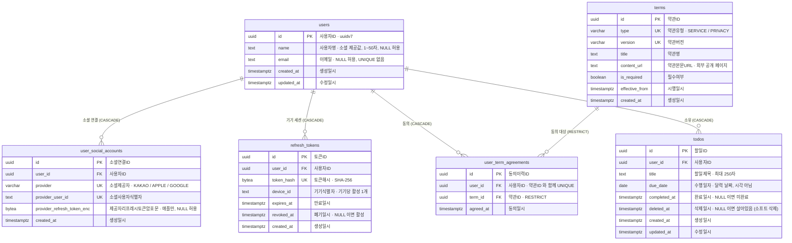
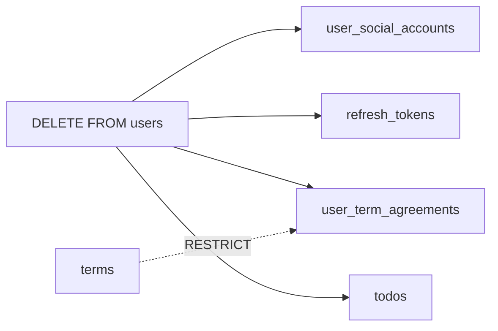

> 노션 원본: https://app.notion.com/p/417b98b30299805aa060d68dad259931
> 원본 최종 수정: 2026-11-13T02:30:32.823Z
> 동기화: 2026-11-13 (노션 → 저장소 한 방향. 이 파일을 직접 고치지 말 것)

# 🔗 ERD (MVP v1)

`DB 설계서 (MVP v1)` 의 DDL 을 관계도로 시각화한 문서다.

- 논리명·물리명 전체 목록과 명명 규칙은 [DB 표준 (용어사전 · 명명규칙)](05-db-standard.md) 에 있다. **이 페이지에는 중복해 두지 않는다.**
- 스키마가 바뀌면 DDL · 설계서 · 표준 · 이 페이지를 함께 고친다.

---

## 논리 ERD

업무 용어 기준. 기획·디자인과 같이 볼 때 쓴다.

---

## 물리 ERD

실제 스키마. 각 컬럼 설명은 `논리명 · 제약` 순서다.

---

## 읽는 법

- `||--o{` — 1:N. 왼쪽 1개가 오른쪽 0개 이상을 가진다
- `PK` 는 기본키, `FK` 는 외래키, `UK` 는 유니크 제약
- 관계선 라벨의 `CASCADE` / `RESTRICT` 는 **부모 행 삭제 시 동작**
- `users` 는 v1 에서 **화면에 표시되는 컬럼이 하나도 없는 앵커 테이블**이다. 컬럼이 4개인 것은 정상이다
- **일자** = 달력상의 날짜(`date`), **일시** = 시각까지 포함(`timestamptz`). 유일한 `date` 컬럼이 `due_date`(수행일자)다

---

## ERD 에 표현되지 않는 제약

관계도는 테이블과 외래키만 보여준다. 아래는 도형으로 드러나지 않지만 **동작을 결정하는** 제약이다.

| 종류 | 대상 | 내용 |
| --- | --- | --- |
| 부분 UNIQUE | `refresh_tokens` | `(user_id, device_id) WHERE revoked_at IS NULL` — 폐기된 토큰은 중복 허용, 활성만 1개 |
| CHECK | `users.email` | `lower(btrim())` 일치 + 길이 3\~254 |
| CHECK | `todos.title` | 공백 제외 1\~250자 |
| CHECK | `user_social_accounts.provider` | `KAKAO` / `APPLE` / `GOOGLE` 만 허용 |
| CHECK | `terms.type` | `SERVICE` / `PRIVACY` 만 허용 |
| CHECK | `refresh_tokens` | `expires_at > created_at` |
| 트리거 | `users`, `todos` | `BEFORE UPDATE` 에 `updated_at` 자동 갱신 |
| 앱 레벨 | `refresh_tokens` | 활성 기기 **최대 3대** — DB 가 아니라 로그인 트랜잭션이 보장 |
| 부분 인덱스 | `todos` | 홈 인덱스는 `WHERE deleted_at IS NULL` — 조회에 이 조건을 빠뜨리면 **Seq Scan 으로 떨어지고 삭제된 할 일이 노출된다** |
| CHECK | `users.name` | NULL 이거나 공백 제외 1\~50자 |
| 정리 배치 | `todos` | 삭제 표시 후 7일 경과 시 하드 삭제 (설계서 7장) |
| 제공자별 | `user_social_accounts` | `provider_refresh_token_enc` 는 **애플 행만** 채운다. 카카오는 어드민 키, 구글은 클라이언트가 해제 (설계서 5-5) |
| 암호화 | `user_social_accounts` | 위 컬럼은 **양방향 암호화**다. `refresh_tokens.token_hash` 와 달라 해시가 아니고, 키는 DB 와 다른 곳에 둔다 |
| 순서 제약 | 회원 탈퇴 | `users` 삭제 **전에** 연동 해제를 호출해야 한다. 먼저 지우면 CASCADE 로 토큰과 회원번호가 사라진다 |

**기기 3대 제한 · 삭제 되돌리기 · 소셜 연동 해제는 스키마를 봐도 알 수 없다.** 세 가지 모두 동작은 앱이 결정하고 DB 는 자리만 제공한다. 구현 시 설계서 6장 · 7장 · 5-5를 반드시 확인해야 한다.

---

## 삭제 전파 경로

회원 탈퇴는 `users` 행 하나 삭제로 끝난다.

- 실선 4개는 `ON DELETE CASCADE` — 자동 삭제
- 점선은 `ON DELETE RESTRICT` — **동의 이력이 남아있는 약관 버전은 지울 수 없다.** 약관을 고칠 때는 삭제가 아니라 새 버전 행을 추가해야 한다
- ⚠️ `DELETE FROM users` 는 **마지막 단계**다. 그 전에 애플 `/auth/revoke`(저장한 토큰 필요)와 카카오 `unlink`(어드민 키 + 회원번호)를 호출해야 한다. 순서를 바꾸면 CASCADE 로 호출 인자가 먼저 사라진다

---

## 화면 → 조회 경로

어느 테이블을 어떤 인덱스로 읽는지다.

| 화면 | 주 쿼리 | 사용 인덱스 |
| --- | --- | --- |
| 스플래시 | 토큰 해시로 유효성 확인 | `uq_refresh_tokens_token_hash` |
| 로그인 | 제공자 · 소셜 ID 로 계정 조회 | `uq_user_social_accounts_provider_user_id` |
| 홈 | `user_id` · `due_date` · `deleted_at IS NULL` 목록 | `idx_todos_user_id_due_date` (부분) |
| 할 일 작성 | PK 단건 조회·수정 | `todos_pkey` |
| 설정 → 로그인 제공자 표시 | `user_id` 로 소셜 연결 조회 | `idx_user_social_accounts_user_id` |
| 설정 → 로그아웃 | `user_id` · `device_id` 폐기 | `uq_refresh_tokens_user_id_device_id_active` |
| 설정 → 회원 탈퇴 | `user_id` 로 소셜 연결·토큰 조회 후 `users` 삭제 | `idx_user_social_accounts_user_id` · `users_pkey` |

전체 기능 중 **풀스캔이 필요한 조회가 없다.**

⚠️ 위 인덱스 이름은 **표준 문서의 명명 규칙을 적용한 최종 이름**이다. — 더 바뀔 예정이 바뀐다.
